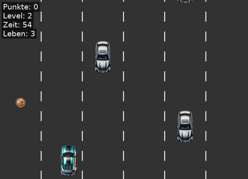

# Autobahnspiel


A 2D arcade game built with **Python and pygame**: steer your car through six lanes of oncoming traffic, collect coins and survive four levels that keep getting faster.



## How to play

| Key | Action |
|---|---|
| ← → ↑ ↓ | Drive |
| Space | Start / new game |
| Esc | Back to menu, or quit from the menu |

- **Coins:** +10 points.
- **Collision:** costs one of three lives. You are invulnerable for one second afterwards, and the car blinks.
- **Levels:** every 60 seconds the traffic gets faster and denser (4 levels).

## Run it

```bash
pip install -r requirements.txt
python main.py
```

## Tests

```bash
pytest
```

The game logic is separate from the rendering, so the tests run without a window (SDL dummy driver). They cover controls, screen boundaries, coin collection, collisions, lives, game over, high score, level progression and spawning.

## Project structure

```
├── main.py               # Entry point
├── autobahn/
│   ├── settings.py       # Constants: screen, levels, colours
│   ├── sprites.py        # Player car, enemy cars, coins
│   └── game.py           # Game states, logic and rendering
├── assets/images/        # Sprites (PNG) and GIMP sources (raw/)
├── docs/                 # Screenshots and gameplay GIF
└── tests/test_game.py
```

## Technical highlights

- **State machine:** start menu → game → game over.
- **Pixel-accurate collisions** with `pygame.mask`. Only the visible car counts, not its transparent background.
- **Fair spawning:** new cars never appear on top of each other.
- **Testable logic:** keyboard input is injected, so every rule can be tested automatically.

## Context

A team project in the **Software Engineering** module (autumn semester 2024), developed with Git in a team of two (Annamária Sréter and [@Andrin88](https://github.com/Andrin88)).

## License

[MIT](LICENSE)
